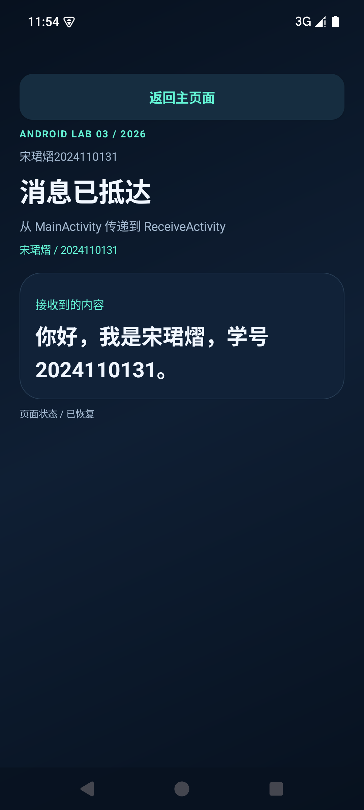
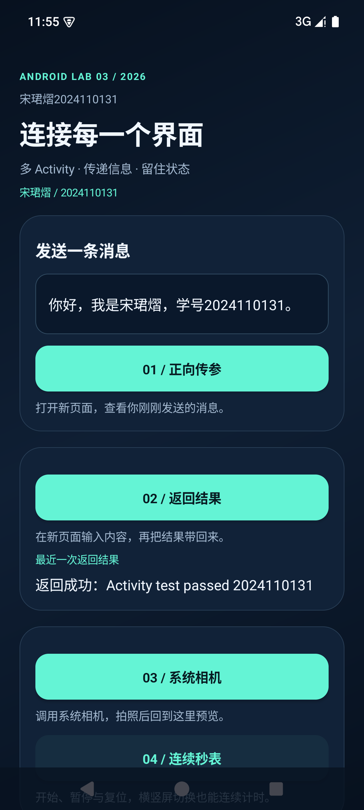
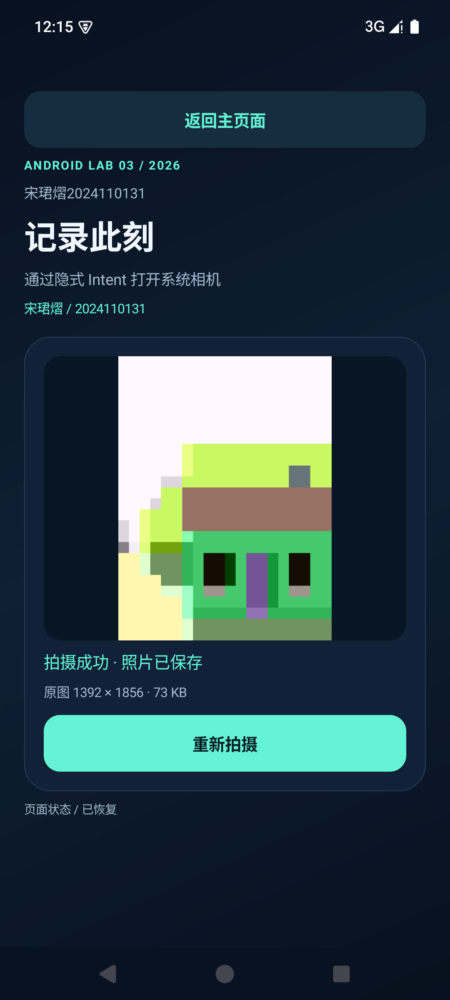
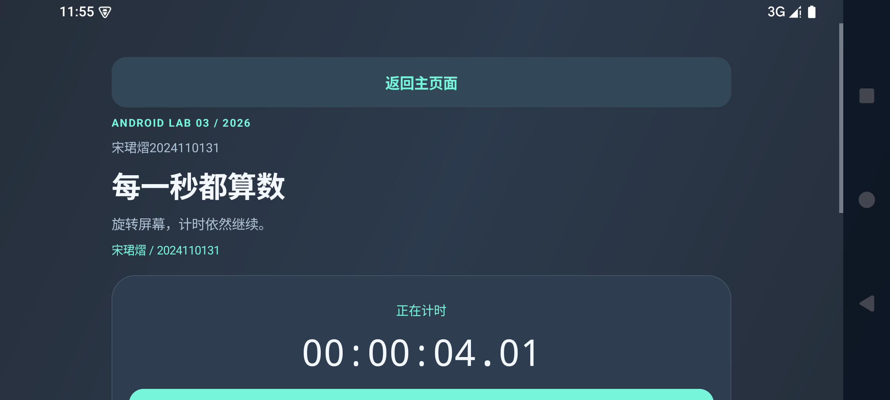

# 实验三 多 Activity

作者：宋珺熠（2024110131）。应用标题为 **宋珺熠2024110131**。

Android Studio 独立工程，包含一个主 Activity 和四个二级 Activity。界面采用深色背景、青绿色按钮和圆角面板，支持横竖屏自然重建。所有界面文案和时间格式均来自字符串资源。

## 作业要求对应

| 要求 | 实现 |
| --- | --- |
| 主页面四个入口 | MainActivity |
| 正向传参并显示 | 显式 Intent + putExtra → ReceiveActivity |
| 输入内容并返回主页面 | ResultActivity 的 setResult、finish；主页面处理 onActivityResult |
| 隐式调用系统相机 | ACTION_IMAGE_CAPTURE + EXTRA_OUTPUT + 临时 content URI 授权 |
| 显示并恢复完整照片 | CameraActivity + 受限的 PhotoProvider，保存照片文件名 |
| 横竖屏连续秒表 | StopwatchActivity，elapsedRealtime + onSaveInstanceState |
| 生命周期观察 | LabActivity，Logcat 标签 ActivityLifecycle |
| 无硬编码界面文案 | res/values/strings.xml |

Manifest 中恰好声明 5 个 Activity。LabActivity 是共享的抽象基类，PhotoProvider 是照片文件提供器，不是额外的页面。没有通过锁定方向或 configChanges 绕过旋转时的生命周期重建。

## 在 Android Studio 中运行

1. 打开本目录，选择 Android Studio 内置 JBR，完成 Gradle 同步。
2. 编译 SDK 为 35，最低支持 Android API 23；本次实测设备为 API 35 模拟器。
3. 选择模拟器或真机，运行 app。第三个入口调用设备的系统相机，因此设备需要安装能响应拍照 Intent 的相机应用。
4. 在 Android Studio Terminal 中也可运行下面的 Gradle 命令。首次使用需联网下载依赖；本机已有缓存时可添加 --offline。

```powershell
.\gradlew.bat :app:assembleDebug :app:lintDebug
```

工程路径可以保持在当前工作区，不需要映射临时 X: 盘。调试 APK 输出在 app/build/outputs/apk/debug/app-debug.apk。

## 状态保存

- 主页面：输入框具有稳定资源 ID，Android 保存视图状态；返回结果另存入 Bundle。
- 正向传参：消息存在启动 Intent 中，重建页面时重新读取。
- 返回页面：输入框由 Android 保存，旋转不丢失草稿。
- 相机：Bundle 保存已显示及待拍摄文件名；原图在应用私有目录，采样解码后预览。取消重拍保留旧照片。
- 秒表：保存累计时间、开始时刻、运行标志和计次数据。Handler 只刷新显示，后台和旋转期间继续根据单调时钟计算时间。空格键可以开始或暂停。

Kotlin 中的 Bundle key、Intent extra 名、日志事件名和 MIME 类型是技术标识；用户输入原样显示。它们与界面提示文案的资源化要求不同。

## 已完成的实际验证

在 API 35 模拟器上安装和启动了 APK。传参、传参旋转恢复、空输入拦截、返回结果及旋转恢复、取消返回保留旧结果均通过。

秒表实测：竖屏读数 2.47 秒，继续后横屏读数 4.41 秒，再恢复竖屏为 5.97 秒。暂停保持读数、暂停旋转、继续计时和复位归零均通过。

系统相机返回完整原图 1392 × 1856，约 73 KB；照片旋转恢复和取消重拍保留旧照片通过。照片中的图案是模拟器相机提供的模拟场景。

assembleDebug 和 lintDebug 通过。Lint 为 0 个错误、5 个警告，涉及 SDK 版本升级建议、框架 ExifInterface 和备份规则。验证范围为 API 35 模拟器，其他 Android 版本和品牌真机尚未验证。

真实运行截图、源码摘录、测试结果 JSON 和生命周期日志位于 report-assets。实验报告位于 docs。






## 验证脚本与报告生成

scripts/device_checks.py 使用 ADB 对真实模拟器进行验证，临时设置屏幕方向后会恢复原设置。由于秒表高频刷新会影响 UIAutomator 获取空闲状态，脚本通过物理空格键短暂停表读取时间，再恢复并旋转。

scripts/camera_checks.py 用于拍摄确认后的照片恢复及取消重拍检查。相机按钮操作可直接通过 ADB 完成。

scripts/build_report_wps.ps1 使用 WPS 的 kwps.Application COM 接口打开下载的模板、填写正文、插入真实截图和代码摘录，再导出 PDF 检查排版。生成过程不使用桌面点击自动化。脚本中的本机工具路径可按环境修改。

## 参考

- 课程附件《采用隐式Intent调用相机拍照功能》
- [Android 官方拍照文档](https://developer.android.com/media/camera/camera-deprecated/photobasics)
- [Activity 生命周期](https://developer.android.com/guide/components/activities/activity-lifecycle)
- 项目地址：https://github.com/StephenYI43/multi-activity-2024110131
